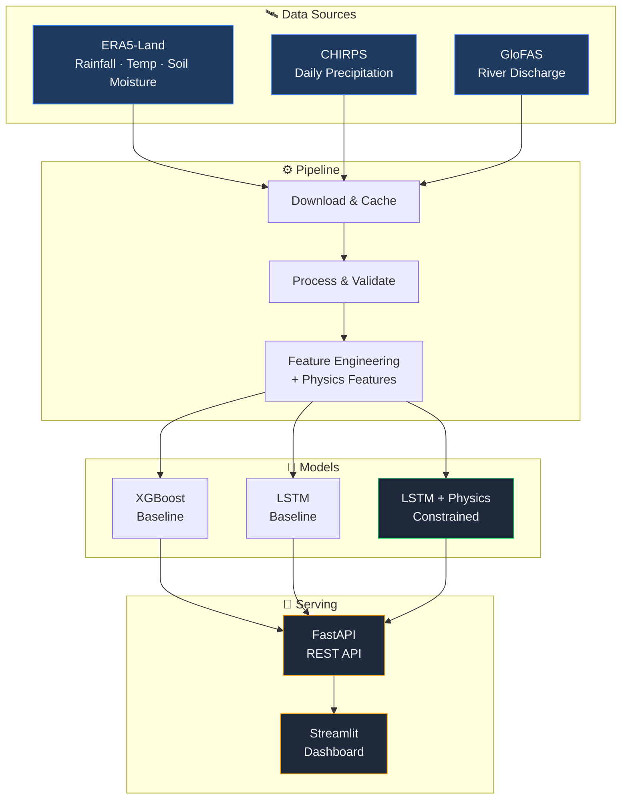

<div align="center">


<br/>


<br/>

[](https://python.org)
[](https://pytorch.org)
[](https://xgboost.readthedocs.io)
[](https://streamlit.io)
[](https://fastapi.tiangolo.com)

<br/>

[](tests/)
[](https://github.com/astral-sh/ruff)
[](LICENSE)
[](https://github.com/estkayon/FloodCast-BD-Jamuna/actions)

<br/>

[Dashboard](https://floodcast-bd.streamlit.app) · [Results](RESULTS.md) · [Reproducibility](REPRODUCIBILITY.md)

</div>

---

## What is FloodCast BD?

A **physics-informed machine learning pipeline** that predicts flood events for Bangladesh's Jamuna River Basin (Sirajganj) **1 to 3 days ahead**. It combines ERA5-Land satellite reanalysis with hydrological domain constraints to produce physically consistent predictions.

**27 experiments** = 3 models (XGBoost, LSTM, LSTM+Physics) x 3 feature sets x 3 lead times, all tracked with MLflow.

<details>
<summary><b>Why Physics Constraints?</b></summary>
<br/>

Standard ML models can learn spurious correlations. FloodCast enforces two physical laws in the LSTM loss function:

| Constraint | What it enforces |
|:---|:---|
| **Monotonicity Penalty** | Higher cumulative rainfall must increase flood probability |
| **Discharge Correlation** | Predictions must correlate with upstream river discharge |

This reduces false negatives during critical flood events where pure data-driven models might fail.

</details>

---

## Architecture



---

## Experiment Matrix

<div align="center">

|  | **Set A** (Basic) | **Set B** (Extended) | **Set C** (Physics) |
|:---:|:---:|:---:|:---:|
| **XGBoost** | 1d · 2d · 3d | 1d · 2d · 3d | 1d · 2d · 3d |
| **LSTM** | 1d · 2d · 3d | 1d · 2d · 3d | 1d · 2d · 3d |
| **LSTM + Physics** | 1d · 2d · 3d | 1d · 2d · 3d | 1d · 2d · 3d |

*27 experiments total · Holdout validation (2023-2025) · All tracked in MLflow*

</div>

See [RESULTS.md](RESULTS.md) for the full comparison table.

---

## Study Area

<div align="center">

| Parameter | Value |
|:---|:---|
| **River** | Jamuna (Brahmaputra) |
| **Station** | Sirajganj |
| **Bounding Box** | 24.0°N - 25.5°N, 89.0°E - 90.5°E |
| **Period** | 2000 - 2025 (25 years) |
| **Target** | Binary flood label (runoff > 90th percentile) |

</div>

---

## Quick Start

<details>
<summary><b>Prerequisites</b></summary>

- Python 3.11, Conda (recommended)
- CDS API account (free) for ERA5/GloFAS data: [Register](https://cds.climate.copernicus.eu/)
- Docker (optional)

</details>

```bash
# Clone & install
git clone https://github.com/estkayon/FloodCast-BD-Jamuna.git
cd FloodCast-BD-Jamuna
conda create -n floodcast python=3.11 -y
conda activate floodcast
pip install -r requirements.txt

# Download, process, train
python -m floodcast.data.download_era5
python -m floodcast.data.download_chirps
python -m floodcast.data.download_glofas
python -m floodcast.data.process
python -m floodcast.features.build
python -m floodcast.models.train

# Run dashboard
streamlit run src/floodcast/dashboard/app.py
```

> **Windows PowerShell** — set PYTHONPATH in each new terminal:
> ```powershell
> $env:PYTHONPATH = "$(Get-Location)\src"
> ```

See [REPRODUCIBILITY.md](REPRODUCIBILITY.md) for full step-by-step guide.

---

## Docker

```bash
docker-compose up
```

| Service | URL |
|:---|:---|
| API | http://localhost:8000 |
| API Docs | http://localhost:8000/docs |
| Dashboard | http://localhost:8501 |

---

## Project Structure

<details>
<summary><b>Click to expand</b></summary>

```
FloodCast-BD-Jamuna/
├── src/floodcast/
│   ├── config.py                 # Pydantic settings
│   ├── data/
│   │   ├── download_era5.py      # ERA5-Land via CDS API
│   │   ├── download_chirps.py    # CHIRPS via HTTP
│   │   ├── download_glofas.py    # GloFAS via CDS API
│   │   ├── process.py            # Merge & clean
│   │   └── validate.py           # Schema validation
│   ├── features/
│   │   ├── engineer.py           # Feature transforms
│   │   ├── physics.py            # Physics-based features
│   │   └── build.py              # Feature pipeline
│   ├── models/
│   │   ├── evaluate.py           # Metrics & evaluation
│   │   ├── xgboost_model.py      # XGBoost
│   │   ├── lstm_model.py         # LSTM
│   │   ├── lstm_physics.py       # LSTM + Physics constraints
│   │   └── train.py              # Training orchestrator
│   ├── api/
│   │   ├── app.py                # FastAPI app
│   │   ├── routes.py             # Endpoints
│   │   ├── schemas.py            # Pydantic models
│   │   └── dependencies.py       # DI
│   └── dashboard/
│       ├── app.py                # Streamlit main
│       ├── theme.py              # Dark theme constants
│       └── views/
│           ├── model_performance.py  # Experiment results
│           └── historical.py         # Historical + predictions
├── tests/                        # 72 tests
├── docker/
│   ├── Dockerfile.api
│   └── Dockerfile.dashboard
├── docker-compose.yml
├── .github/workflows/
│   ├── ci.yml                    # Lint + Test
│   └── cd.yml                    # Docker build
├── dvc.yaml
├── requirements.txt
├── pyproject.toml
├── REPRODUCIBILITY.md
└── RESULTS.md
```

</details>

---

## Tech Stack

<div align="center">

| Category | Technologies |
|:---|:---|
| **ML / DL** | PyTorch 2.2, XGBoost 2.0, Optuna |
| **Data** | pandas, xarray, netCDF4, DVC |
| **API** | FastAPI, uvicorn, pydantic |
| **Dashboard** | Streamlit |
| **MLOps** | MLflow, Docker, GitHub Actions |
| **Quality** | ruff, mypy, pytest |

</div>

---

## Testing

```bash
pytest tests/ -v          # 72 tests
ruff check src/ tests/    # Linting
```

<details>
<summary><b>Test Coverage Breakdown</b></summary>

| Module | Tests |
|:---|:---:|
| Data Pipeline | 16 |
| Features | 10 |
| Models | 11 |
| API | 12 |
| Dashboard | 10 |
| Docker & Deployment | 13 |
| **Total** | **72** |

</details>

---

## Limitations

- Research prototype, **not** an operational flood warning system
- Predictions are for Jamuna at Sirajganj only; other basins require retraining
- No real-time data ingestion; uses historical satellite reanalysis
- CPU-only training; large experiments benefit from GPU
- Model accuracy depends on ERA5/CHIRPS/GloFAS data quality

---

## Documentation

| Document | Description |
|:---|:---|
| [REPRODUCIBILITY.md](REPRODUCIBILITY.md) | Step-by-step experiment reproduction |
| [RESULTS.md](RESULTS.md) | Full model comparison results |

---

## Author

<div align="center">

**Md. Estiak Rahman Ayon**

[](https://github.com/estkayon)
[](https://linkedin.com/in/md-estiak-rahman-ayon)
[](https://estkayon.github.io/Portfolio/)

</div>

---

## License

This project is licensed under the [MIT License](LICENSE).

---

<div align="center">


</div>
